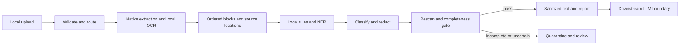

# Proposed functional blueprint

Raw evidence remains inside the local processing boundary. Future scale: job queue, bounded OCR workers and document-level isolation. Final technical architecture must specify actual selected libraries, storage, deployment and failure recovery; these are not implemented.
